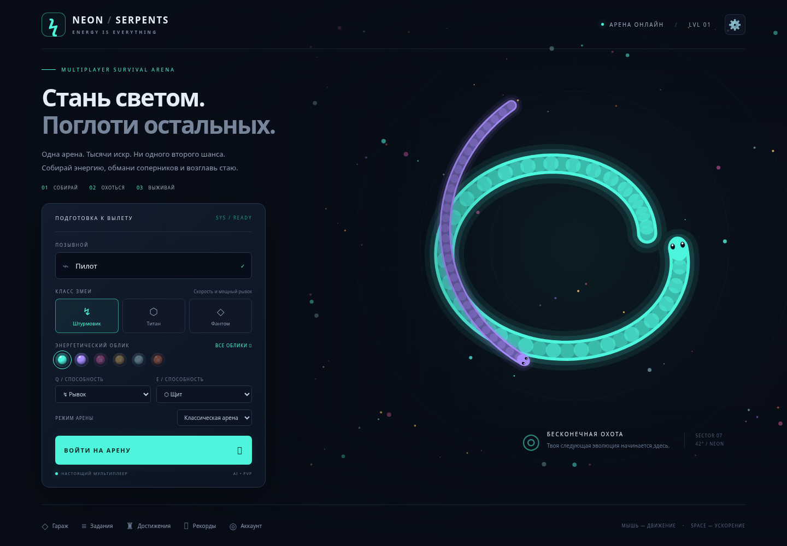

# NEON SERPENTS

Браузерная IO-арена с настоящим авторитетным сервером: 40 AI-змей, PvP, три режима, классы, способности, события, босс и сохраняемая прогрессия. Графика и звук процедурные; внешние изображения, шрифты и платные API не нужны.



## Быстрый запуск на Windows 10

1. Установите **Node.js 24 LTS** с https://nodejs.org (минимум 22.13).
2. Откройте терминал в папке проекта:

```powershell
npm install
npm run dev
```

Откройте **http://localhost:5173**. Сервер работает на порту 3001, Vite проксирует API и Socket.IO. Можно запустить `START_WINDOWS.bat`. Для остановки — Ctrl+C. Chrome, Edge, Firefox используют стандартные Canvas 2D / Pointer Events / WebSocket; реальные Windows и Android устройства в облачной среде не проверялись.

Production-запуск:

```powershell
npm run build
npm start
```

Откройте http://localhost:3001. Это локальный адрес, не публичная ссылка.

## Как играть

Введите позывной, выберите класс, облик, режим и две разные способности. Нажмите «Войти на арену». Голова движется постоянно, тело следует за ней. Собирайте светящиеся сферы; врезаясь головой в чужое тело или стену, змея погибает и оставляет энергию. Собственное тело игрока не смертельно; боты избегают его при выборе траектории. Одновременные лобовые столкновения разрешаются последовательным серверным шагом.

- **Мышь** задаёт направление, **ЛКМ / Space** ускоряют с расходом энергии и массы.
- **Q / E** применяют выбранные способности; стоимость и перезарядка проверяются сервером.
- **Escape** открывает меню (мультиплеер не ставится на паузу), **Tab** расширяет TOP-10.
- Android: левый джойстик, правая кнопка BOOST, две кнопки способностей; мультитач.
- Настройки: качество, звук, FPS/ping, переназначение клавиш, полноэкранный режим.

**Штурмовик** быстрее и сильнее ускоряется рывком. **Титан** медленнее, собирает больше массы, его щит выдерживает два удара. **Фантом** быстрее поворачивает, имеет продлённого призрака и менее заметен при ускорении.

Способности: рывок, щит, магнит, импульс (отталкивание голов, не проходит через стены), призрак (проход сквозь тела, но не сквозь стены/границу).

Режимы занимают отдельные комнаты: **классический**, **овердрайв** (скорость ×1.18, рост ×1.5, чаще события), **хардкор** (нет стартового щита, дороже ускорение). Переполненная комната создаёт следующую арену.

События начинаются через 55 секунд, затем каждые 75–120 секунд в зависимости от режима. Порядок пяти событий перемешивается для каждой арены: дождь энергии, золотая зона, электрическая буря, охота за лидером и древний змей. Буря истощает массу и энергию, золотая зона усиливает сбор, уничтожение отмеченного лидера даёт массу. Босс меняет поведение в трёх фазах. **Импульс** наносит ему 18 урона, контакт с его телом в режиме **Призрака** также наносит урон. Последний атакующий получает заслугу убийства; босс оставляет много энергии. События действуют 45 секунд.

## Прогресс и аккаунты

Гость получает серверную сессию в HttpOnly cookie на 30 дней. Обновление страницы и перезапуск сервера не удаляют прогресс при сохранённой SQLite. В разделе «Аккаунт» зарегистрируйте логин и пароль (минимум 10 символов), чтобы войти с другого устройства. Пароли хранятся как scrypt-хеш с уникальной солью, сессионные токены — как SHA-256-хеши. Cookie в production должна быть Secure.

Один аккаунт одновременно играет только в одной вкладке. Для двух устройств используйте разные гостевые профили/аккаунты. Сетевой обрыв завершает текущий матч; после восстановления связи клиент автоматически начинает новый полёт. Это намеренное правило: непрерывное восстановление прежней змеи после обрыва не реализовано.

XP, кредиты, результаты, достижения и задания считаются **только сервером**, при смерти/выходе/отключении. Нет награды за мгновенный выход без игровых действий. 17 достижений автоматически начисляют кредиты; ежедневные и повторяемые задания нужно забрать в меню. В гараже можно покупать и экипировать цвета, звёздный след, корону, эффект смерти и волну движения. Новая косметика применяется в следующем полёте. Платежей нет.

SQLite расположена в `data/neon.sqlite` (WAL). Делайте резервные копии через SQLite backup API либо после штатной остановки сервера, включая WAL при работающем сервере. Не удаляйте том `data` при обновлении. Интерфейс хранилища выделен в `server/persistence/store.js`; PostgreSQL требует реализации аналогичного адаптера и асинхронных вызовов, готового адаптера в этом релизе нет.

## Android и два устройства

**В одной Wi-Fi сети:**

1. Запустите `npm run dev` на ПК, узнайте IPv4 через `ipconfig`.
2. Разрешите Node.js/порты 5173 и 3001 в брандмауэре для **частной сети**.
3. На телефоне откройте `http://<IPv4-ПК>:5173` в Chrome. Не используйте `localhost` телефона.
4. Откройте игру на ПК и телефоне, выберите один режим и разные аккаунты, войдите на арену.
5. Для нестандартных подсетей задайте `ALLOWED_ORIGINS=http://<IPv4-ПК>:5173` в `.env`.

Production-сервер на 3001 доступен в LAN по одному адресу; Vite для production не нужен.

**Через интернет:** разместите Node-сервер с постоянным диском и WebSocket-поддержкой, подключите свой домен и HTTPS. Оба устройства открывают **один и тот же публичный HTTPS-адрес**. Сам проект публичный URL не создаёт.

Ручная проверка Android: портрет и альбомная ориентация; джойстик + BOOST одновременно; отпускание пальца за пределами кнопки; Q/E-кнопки во время движения; fullscreen; уход приложения в фон; reconnect; меню с прокруткой; повторный вход и сохранение наград. В fullscreen оставлены safe-area отступы. Браузерная эмуляция не заменяет физическое устройство.

## Публикация

На Node-хостинге установите Node 24, build command `npm ci && npm run build`, start command `npm start`. Нужен постоянный диск, `DATA_DIR` указывает на него. Environment:

```dotenv
PORT=3001
HOST=0.0.0.0
DATA_DIR=/persistent/neon
BOT_COUNT=40
ROOM_CAPACITY=24
COOKIE_SECURE=true
TRUST_PROXY=1
ALLOWED_ORIGINS=https://game.example.com
```

`TRUST_PROXY=1` используйте только за одним доверенным reverse proxy; прямой вход в порт сервера в production ограничьте. Caddy-конфигурация с автоматическим TLS находится в `deploy/Caddyfile`: замените домен, настройте DNS и порты 80/443. Socket.IO и API должны идти через тот же origin. HTTPS-proxy автоматически переводит WebSocket в WSS. Readiness endpoint: `/api/health`.

Docker:

```sh
docker compose up --build -d
```

Сервер будет на порту 3001, SQLite — в постоянном томе `neon-data`. Для production добавьте указанные переменные в compose и TLS-proxy. На первом этапе используйте **один процесс сервера**: комнаты хранятся в памяти, состояние мира не разделяется между репликами. Для масштабирования нужны координатор комнат, общий storage и sticky routing; это будущая работа. Бесплатный хостинг без постоянного диска потеряет прогресс при пересоздании контейнера.

## Конфигурация

Скопируйте `.env.example` в `.env` при необходимости. Скрипты Node читают его автоматически. Значения окружения имеют приоритет. Боты ограничены 0–100, размер комнаты — 2–64. Клиент видит только окрестности камеры, результаты не принимает от клиента. Входы/регистрация/API/способности/сообщения управления ограничиваются по частоте, Origin проверяется, JSON ограничен 8 КБ. Для публичного массового запуска нужна отдельная нагрузочная проверка и настройка лимитов под reverse proxy.

## Проверки

```sh
npm test
npm run build
npx playwright install chromium
npm run test:e2e
npm run profile
```

На Linux с установленным Chromium можно не скачивать браузер:

```sh
CHROMIUM_PATH=/usr/bin/chromium npm run test:e2e
```

Unit/integration: движение, ограничения поворота, тела, столкновения, смерть, энергия, ускорение, все способности, классы, шесть AI-моделей, события, босс, режимы, два реальных Socket.IO-клиента, комнаты, валидация, SQLite reopen, login, награды и магазин. E2E: главное меню и все панели, полёт, сохранение, регистрация/login, два браузерных контекста, Android-viewport и настоящий мультитач через Chromium CDP. Скриншоты — в `test-results/`. E2E запускает отдельный сервер на 3010 (можно изменить `E2E_PORT`) и отдельную SQLite в системной временной папке, не используя dev-базу.

Профиль измеряет **серверный** шаг с 40 ботами на 60 секундах симуляции. Не измеряет FPS физических Android/Windows устройств. В игре можно включить реальный FPS/ping и снизить графику.

## Структура

- `shared/catalog.js` — правила, классы, способности, косметика, достижения, задания.
- `server/game/` — фиксированный шаг 30 Hz, пространственная сетка, мир/события/коллизии.
- `server/ai/` — шесть моделей с разной реакцией, перехватом и оценкой безопасной траектории.
- `server/networking/` — отдельные комнаты; `server/index.js` — API и сетевой протокол.
- `server/persistence/` — SQLite, аккаунты и серверная прогрессия.
- `client/src/` — Canvas, ввод, синтез звуков, сеть, UI.

Данные обновляются по сети около 15 раз в секунду, клиент интерполирует тело между снимками. Координаты тела округляются только при передаче; сервер хранит точные значения. Live-процессы и мир не сохраняются при перезапуске; аккаунты и результаты сохраняются.

### Сборка в облачной сети с прокси

В этой среде BuildKit не наследует сетевые настройки процесса автоматически. Для проверки контейнера использованы стандартные build args `HTTP_PROXY`, `HTTPS_PROXY`, `NO_PROXY`, разрешение имени прокси через `--add-host` и временный `--secret id=cloud_ca,src=<CA-файл среды>`. Dockerfile поддерживает этот необязательный CA; сертификат не копируется в образ. В обычной сети `docker compose up --build -d` не требует этих аргументов. TLS-проверка при всех установках остаётся включённой.
