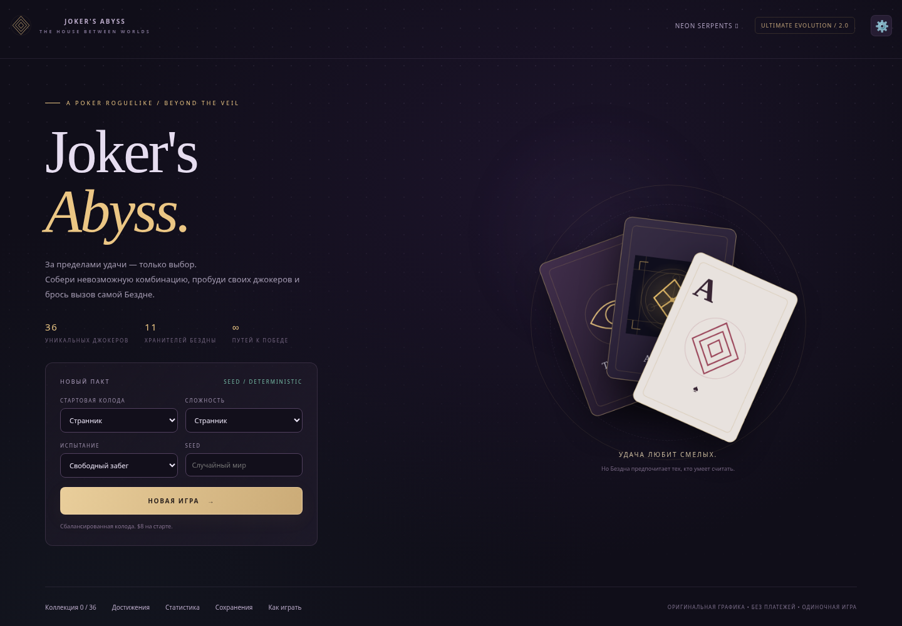

# JOKER’S ABYSS 2.0 — Ultimate Evolution

Покерный roguelike в мистическом неоновом казино: **36 джокеров, 20 эволюций, 11 боссов, 15 испытаний, 32 достижения**, пять открываемых колод, четыре сложности и бесконечный режим. Оригинальная процедурная SVG-графика и Web Audio, без платежей и внешних ассетов.



## Запуск на Windows

Установите **Node.js 24 LTS** с [nodejs.org](https://nodejs.org) (минимум 22.13). Включите npm и Add to PATH, затем откройте новое окно терминала в распакованной папке проекта:

```powershell
npm ci
npm run dev
```

Откройте `http://localhost:5173`. Также работает **START_WINDOWS.bat**: он проверяет Node/npm и выводит понятную инструкцию при отсутствии установки. Файл содержит ASCII и настоящие CRLF, чтобы избежать ошибки с обрывками команд на Windows.

Production: `npm run build`, затем `npm start`; адрес `http://localhost:3001`. Это локальные адреса. Push в GitHub публикует исходники; публичный игровой сайт требует отдельного хостинга. Docker и Caddy сохранены, подробности в [инструкции NEON SERPENTS](docs/NEON_SERPENTS.md).

## Как играть

1. Выберите колоду, испытание и seed или оставьте случайный seed. Нажмите «Новая игра» и начните блайнд.
2. Выберите 1–5 карт. Комбинация, карты, улучшения и джокеры определяют **Chips × Mult**. Руки и сбросы ограничены; невыбранные Steel-карты усиливают множитель.
3. После победы покупайте джокеры, Таро, планеты, спектральные карты, бустеры и ваучеры. Переставляйте джокеры: порядок срабатывания меняет результат.
4. Проклятия дают силу и энергию Бездны, но имеют последствия. Тратьте энергию на улучшение карты, усиление джокера, новый магазин или спектральную карту. Аномалии добровольны и показывают риск и награду до принятия.
5. Пройдите три блайнда каждого Ante. Финальный босс на Ante 8 требует три разных комбинации; в испытании «Малые чудеса» — две. После победы доступен бесконечный режим.

**Enter** — розыгрыш, **Backspace** — сброс, **S** — сортировка, **C** — коллекция, **Escape** — меню. Клавиши переназначаются. Карты и джокеры можно перетаскивать; на телефоне короткий свайп прокручивает ряд, удержание показывает подсказку и позволяет перестановку. У джокеров есть кнопки со стрелками. Сортировка доступна по рангу, масти и улучшению.

Настройки: четыре скорости анимации, частицы, вспышки, реакция стола, контраст, подписи мастей, масштаб карт/текста, отдельные громкости. Звук начинается после пользовательского действия. В «Журнале» показан источник каждого начисления. [Подробные правила математики](docs/SCORING_2_0.md).

## Сохранения

Автосохранение одиночной игры находится **в браузере**, отдельно от аккаунтов змейки. Есть версия формата, проверка данных/контрольной суммы, резервная копия, экспорт и импорт JSON с подтверждением. Перед очисткой браузера, сменой адреса сайта или устройства экспортируйте файл через «Сохранения».

Повреждённые данные не удаляются. При восстановлении резервной копии выводится предупреждение; если обе копии повреждены, игра использует временную память до импорта проверенной копии. Поддерживается миграция собственного документированного формата v1; совместимость с неизвестными сторонними сохранениями не заявляется. [Формат и восстановление](docs/SAVES_2_0.md).

## Прежняя игра сохранена

**NEON SERPENTS** доступна через ссылку в шапке и по `/serpents.html`. Её авторитетный сервер, 40 ботов, PvP, способности, режимы, аккаунты и SQLite-прогресс сохранены. Данные `data/neon.sqlite` не удалялись. [Полная прежняя инструкция](docs/NEON_SERPENTS.md).

## Разработка и проверки

```bash
npm run typecheck
npm test
npm run build
npm run simulate
npm run test:e2e
```

Для системного Chromium: `CHROMIUM_PATH=/usr/bin/chromium npm run test:e2e`. Иначе установите браузер командой `npx playwright install chromium`. E2E использует отдельный порт 3010 и временную SQLite. Симулятор проводит 200 забегов и сохраняет [отчёт](docs/simulation-2.0.json); `npm run simulate -- --seed MY-SEED` воспроизводит выбранный seed. Это эвристический бот, не оценка вероятности победы человека. [Проверки релиза](docs/RELEASE_2_0.md).

Dev-панель открывается **Ctrl+Shift+D** только при `npm run dev`; в production она исключена. Есть выдача конкретного джокера/карты, установка Ante, босса, денег, уровней, seed, просмотр состояния и экспорт диагностики.

Исходная точка сохранена в Git tag `pre-abyss-2.0`; [аудит](AUDIT_2_0.md) объясняет добавление карточных систем к существующему репозиторию. [План](PLAN.md), [состояние](PROGRESS.md), [проверка джокеров](docs/JOKERS_2_0.md).

Физические Windows/Android и Firefox не проверялись. Автоматизация использует Chromium с эмуляцией Android; ручной список проверки находится в отчёте релиза.
